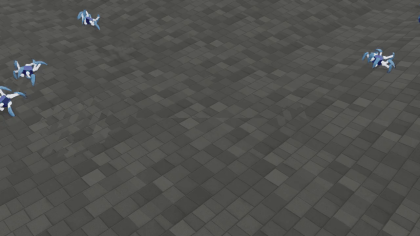
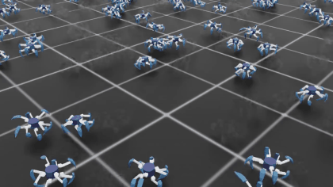

# Arachne — RL Locomotion for an 8-Legged Walking Robot

Arachne is a from-scratch project to train a reinforcement-learning locomotion
policy for a physical 8-legged, 24-servo spider robot — built in [NVIDIA Isaac
Lab](https://isaac-sim.github.io/IsaacLab/) and [skrl](https://skrl.readthedocs.io/),
targeting real hardware rather than a sim-only demo.

This repo doesn't contain the training code — it's a write-up of the engineering
process: the design decisions, the dead ends, the bugs found through actual
training data, and where the project currently stands. I'm sharing it mainly to
show *how* I approach an open-ended robotics/RL problem, not to claim a finished
robot.

## Contents

- [Where this came from](#where-this-came-from)
- [The goal](#the-goal)
- [Starting broad, then deliberately cutting scope](#starting-broad-then-deliberately-cutting-scope)
- [Reward engineering as an empirical process](#reward-engineering-as-an-empirical-process)
- [Trying a second action space in parallel](#trying-a-second-action-space-in-parallel)
- [Training footage](#training-footage)
- [Current status](#current-status)
- [What's next](#whats-next)
- [Why no code here](#why-no-code-here)
- [Stack](#stack)

## Where this came from

This project grew out of a long-standing interest in robotics, combined with
years of hands-on 3D-printing and mechanical prototyping experience — I wanted
to actually build a physical robot, not just simulate one. I also didn't want
to build *just another* gait-walking robot: the part that actually interested
me was a robot that can sense an obstacle in its path and step over or around
it on its own, instead of blindly walking into it. That's why obstacle
perception (the ToF sensor, the vision branch discussed below) is part of the
plan from the start, even though it's currently parked while the core walking
gait gets solid first.

## The goal

A real 8-legged robot (24 joints, 3 per leg: hip / knee / ankle), controlled by
a policy trained in simulation and deployed to:

- 24× MG90S hobby servos driven via 3× PCA9685 PWM boards
- Raspberry Pi 4 / Radxa Zero Pro 2 onboard compute
- IMU for tilt/acceleration, a ToF depth sensor for terrain, camera for teleop video
- An Android app sending velocity commands over the network (same `(lin_vel_x,
  lin_vel_y, yaw_rate)` interface the simulated policy already consumes)

Because the end target is real hardware, not a Gym benchmark score, sim-to-real
concerns (actuator realism, domain randomization, sensor noise) are treated as
first-class design constraints, not an afterthought.

## Starting broad, then deliberately cutting scope

The first version of this project was more ambitious than the current one: a
visuomotor policy that fed a raycaster-simulated depth sensor into a CNN vision
branch, fused with proprioception, trained on randomized rough terrain — closer
to how a real robot with a ToF sensor would eventually need to perceive its
environment.

I pulled that back out. Training a legged robot to walk at all is already a hard
enough problem on its own; stacking perception, rough terrain, *and* an untested
action space on top of it made every failure hard to diagnose — a bad gait could
mean the reward shaping is wrong, the terrain curriculum is wrong, or the vision
branch is wrong, with no clean way to tell which. So I cut the sensing out
entirely and restarted on flat ground with pure proprioception, to get one part
of the problem — stable locomotion — right in isolation first.

That same instinct shaped the sensor plan for the real robot, too: rather than
the ~5 ToF sensors (front/back/left/right/down) that would give the most
complete terrain coverage, the plan starts with *one*, angled forward-and-down.
Each extra sensor is real wiring and bus-addressing complexity on hardware that
doesn't exist yet — easy to add once a concrete blind spot shows up in testing,
expensive to have guessed wrong about upfront.

The vision/rough-terrain branch isn't deleted — it's parked, to be picked back
up once flat-ground locomotion is solid and there's a real baseline to compare
it against.

*The parked raycaster/rough-terrain branch — kept around, not deleted, for
when perception comes back into scope.*

## Reward engineering as an empirical process

Getting a legged robot to produce a clean walking gait from RL is mostly a
reward-shaping problem, and it very rarely goes right on the first attempt. The
project tracks every round of this in a repo-local experiment log (not included
here) — 23 rounds and counting — each entry following the same shape: what
changed, why, and what the actual training run showed, including the failures.
Every reward term is also a small, pure, independently unit-tested function
(close to 100 tests at this point) with no direct simulator access, so a change
to one term's math can't silently change another's.

A few examples of what that process actually surfaced:

- **A reward term that looked harmless on paper collapsed training outright.**
  Enabling a foot-orientation penalty caused the mean reward to fall
  monotonically over 100k steps. The bug: the robot's default standing pose is
  a few degrees off "true vertical" by design, and a symmetric penalty punished
  moving *toward* vertical just as hard as moving away from it — fighting
  normal gait motion in a direction that was actually fine. Confirmed via a
  clean A/B run with everything else held identical.

- **A metric can stay flat while the behavior it's supposed to prevent gets
  worse.** A one-sided fix for the bug above left a whole region of leg
  splay completely unpenalized by construction — the term reported a correct
  zero while the training video showed legs pushed to an extreme. Caught by
  actually watching rendered footage, not by trusting the loss curves — now a
  standing rule for this specific term.

- **A fairness metric that measures the wrong thing can look like it's
  getting worse when the policy is actually improving.** A penalty comparing
  per-leg usage was computed from raw accumulated contact seconds. As episodes
  started surviving longer (a sign of progress), that same raw-seconds formula
  produced a bigger absolute spread for the *same* underlying bias — making a
  genuinely improving policy look like it was regressing. Fixed by normalizing
  against elapsed episode time instead of absolute seconds.

None of that test coverage caught the bugs above, though — they were about
reward *incentives* lining up wrong, not reward *code* being wrong, which is
exactly why actually watching rendered training footage stayed in the loop
rather than trusting metrics and tests alone.

## Trying a second action space in parallel

Alongside the reward work, I also built a second way for the policy to act:
instead of joint angles directly, the policy outputs target foot positions per
leg, converted to joint angles via inverse kinematics before being sent to the
simulated actuators. Building this surfaced its own round of bugs — a leg
ordering mismatch between two different subsystems reading leg names in
different orders, and a forward-kinematics check that revealed the simulated
"foot" body wasn't actually at the toe — each one only found by cross-checking
geometry outputs against the real robot's CAD model and a small live debugging
tool (slider panel driving each leg in real time) rather than trusting the math
in isolation.

The two action spaces — direct joint control and IK-based foot targets — are
meant to be compared empirically once both have a fair training run, rather
than assuming either is better upfront.

## Training footage

The current flat-ground, no-perception baseline — the most stable run so far
out of the reward-tuning process described above. Each of the dozens of
spiders in the grid is the same policy training in a separate parallel
simulated environment at once, not dozens of independent robots.

## Current status

This is an active, unfinished project. Flat-ground joint-space locomotion is
past its early, clearly-broken stages (the robot reliably stays upright and
produces leg-lift behavior) but hasn't converged to a clean, final gait yet —
reward tuning is still ongoing. The IK-based action space has working,
CAD-verified kinematics and an initial training run in progress, not yet
compared against the joint-space baseline. The rough-terrain/perception branch
is intentionally parked until flat-ground locomotion is solid.

No physical hardware has been built yet — the project is currently
simulation-only, with the real-hardware constraints (servo dynamics, sensor
placement, compute budget) actively shaping decisions along the way rather than
left for later.

## What's next

Roughly in order:

1. Converge the flat-ground joint-space gait (ongoing reward tuning).
2. Compare it empirically against the IK-based action space, rather than
   assuming either is better upfront.
3. Layer directional velocity tracking on top of whichever baseline wins
   (the curriculum's Phase 2).
4. Bring the parked raycaster/ToF perception branch back in, now with a
   working locomotion baseline to build on top of instead of debugging both
   at once.
5. Add domain randomization (mass, friction, actuator/sensor noise, latency)
   once there's a trained policy worth transferring, and start the physical
   build.

## Why no code here

This repo is intentionally a write-up, not the training codebase. The code
itself is mid-experiment (reward scales get tuned by hand, branches get
parked and revisited) and wouldn't read as a clean example of anything on its
own without the process notes above to go with it — so I'd rather share the
reasoning directly than a half-finished `env_cfg.py`.

## Stack

NVIDIA Isaac Lab/Isaac Sim · skrl (PPO) · PyTorch · Python
